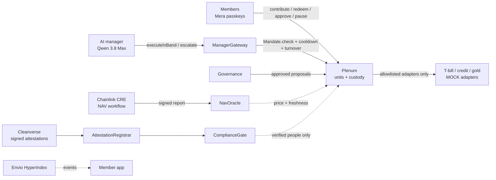

# Plenum

**Who guards the guardian? Your rules do.**

Groups everywhere pool money: investment clubs, families, founders, alumni. Professional management only starts
around $25M, so everyone else runs on spreadsheets and trust in one treasurer. AI can now do that job for almost
nothing, but no group should have to trust an AI with its money.

**Plenum gives a group an AI money manager that is bound by rules the group writes, priced by an independent
administrator, limited to verified people and verified money, and stoppable by the members at any time**, all
enforced by contracts on **Monad testnet**. Individuals can also run a personal portfolio on the same rules.

- **Live app:** https://plenumx.vercel.app
- **Contracts and evidence transactions:** [docs/deployments.md](docs/deployments.md) (14 contracts, all source-verified)
- **Bounty-by-bounty evidence:** [docs/bounty-adherence.md](docs/bounty-adherence.md)
- **Threat model and test results:** [docs/threat-model.md](docs/threat-model.md)

> Hackathon build for **Monad Metropolis, Track 04: Trust, Identity & AI Infrastructure**. Software, not a fund or an
> adviser. Testnet only, test money only. Everything simulated is labelled **MOCK** or **FALLBACK** (see
> [What is real and what is mocked](#what-is-real-and-what-is-mocked)).

## The idea: separation of duties

No single component both manages and prices, or manages and polices. Every arrow into the group's money passes a
check it cannot skip.

| Duty | Held by | Enforced onchain by |
| --- | --- | --- |
| **Manage** | AI manager, through a scoped operator key | `ManagerGateway` + `Mandate.check` on every action |
| **Price** | Chainlink CRE workflow (the fund administrator) | `NavOracle`: accepts the CRE forwarder only |
| **Police** | Cleanverse identity attestations | `CleanverseAttestationRegistrar` → `ComplianceGate` |
| **Own and decide** | Members, with Mera passkey accounts | `Governance`: approve bigger moves, pause the manager |



**The security claim the tests prove:** the worst a fully compromised manager can do is move money between assets the
group already approved, within size, turnover and cooldown limits. **It can never withdraw.**

## How a group runs

1. **Start a group.** Pick Conservative, Balanced or Liquidity-first. The template becomes the mandate: allowed assets,
   target weights and ranges, a cash floor, and caps on single trades (10% of value) and daily trading (25%).
2. **Invite verified people.** Single-use signed invite links. Only people with a valid Cleanverse attestation can join
   or move money; an unverified contribution is refused onchain and the refusal is logged.
3. **Contribute.** Members get units priced at the latest independent valuation, shown in their own currency.
4. **The manager works.** It observes, plans, simulates every move against the contracts, then either acts within the
   rules or escalates. Each action commits a hash of its reasoning and the model id onchain.
5. **Members stay in charge.** Bigger moves need their approval (one passkey transaction each). Any two members can
   pause the manager instantly. Members share private data with the manager only through expiring onchain consent.

## What is in the box

| Folder | What |
| --- | --- |
| [`contracts/`](contracts) | Foundry: `Plenum`, `Mandate`, `ManagerGateway`, `Governance`, `NavOracle`, `ComplianceGate`, `CleanverseAttestationRegistrar`, `ConsentRegistry`, `PlenumFactory` (per-group clones), MOCK adapters and A-Token |
| [`agent/`](agent) | AI manager runtime (observe → plan → simulate → act → explain), seven tools and no transfer tool, red-team suite |
| [`cre/`](cre) | Chainlink CRE NAV workflow (TypeScript SDK, compiled to WASM) |
| [`indexer/`](indexer) | Envio HyperIndex (HyperSync), hosted on Envio |
| [`app/`](app) | Next.js member app on Vercel: Mera passkeys, groups and personal portfolios, approvals, data room |
| [`packages/crypto/`](packages/crypto) | Data-room crypto: HKDF(passkey PRF) → X25519, AES-256-GCM, HPKE key wrapping |
| [`docs/`](docs) | Spec, deployments, threat model, bounty adherence |

## Tests and security

| Suite | Result |
| --- | --- |
| Contracts (unit, fuzz, invariants) | **111 passing**, including 7 handler-based invariants at 16,384 random calls each |
| Red team RT-1..RT-8 (prompt injection, invented adapters, stale prices, oversized trades, turnover evasion, stolen key, expired consent) | **10/10** against the real runtime and contracts |
| Data-room cryptography | 9 passing, derivation cross-checked against Node's HKDF / X25519 |
| Static analysis | Slither and Aderyn: every finding fixed or explained in [docs/threat-model.md](docs/threat-model.md) |
| Onchain | A forced call with the manager's own key to an outside address **reverts** ([tx](https://testnet.monadvision.com/tx/0x42254307eb4048176a04c67bf922b97168c8dfdd05775cdc5d1455758dbc3c3f)) |

CI runs the contract, agent, crypto, indexer and app checks on every push.

## Why Monad

1. **Checks on every action stay cheap.** Each manager action runs mandate, compliance and price-freshness checks
   onchain. Low fees keep that safety invisible to members and keep small contributions viable.
2. **A tight agent loop.** Sub-second blocks keep the gap between the manager's simulation and its execution short, so
   what it checked is what it gets.
3. **Native trust tooling.** Mera passkey accounts, Chainlink CRE support for Monad, Envio HyperSync for Monad, and
   the Cleanverse identity stack all run on Monad testnet.
4. **The asset shelf exists.** The MOCK adapters follow the ERC-4626 / ERC-7540 shapes used by tokenised funds, so real
   ones can replace them.

## What is real and what is mocked

| Real | MOCK or FALLBACK |
| --- | --- |
| All Plenum contracts, deployed and verified on Monad testnet | T-bill vault, private-credit vault and gold: **MOCK** adapters |
| Mandate, governance, pause, consent and every safety check | Settlement asset: **MOCK** A-Token with Cleanverse-style transfer gating |
| Chainlink CRE workflow pricing the fund onchain | Cleanverse attestation **signer**: a MOCK key until Cleanverse issues one (`setSigner` swaps it) |
| Cleanverse attestation path (EIP-712, replay and expiry protection) | **FALLBACK** price writer: demo resilience only, labelled in the UI |
| Envio indexer, Mera passkey accounts, encrypted data room | |

## Run it locally

Requirements: Node 22+, pnpm, Foundry. Optional: the CRE CLI (`cre login`) and Docker (local indexer).

```sh
pnpm install
cd contracts && forge build && forge test                        # 111 tests
anvil &                                                          # local chain
forge script script/Deploy.s.sol --rpc-url http://127.0.0.1:8545 --broadcast
forge script script/Rehearsal.s.sol --rpc-url http://127.0.0.1:8545 --broadcast
cd ../agent && pnpm test && pnpm redteam                         # agent unit tests and red team
cd ../app && NEXT_PUBLIC_CHAIN_ID=31337 pnpm dev                 # member app on localhost
```

Monad testnet deployment, CRE simulation, the hosted indexer and Vercel are documented in
[`contracts/`](contracts), [`cre/README.md`](cre/README.md), [`indexer/README.md`](indexer/README.md) and
[`app/README.md`](app/README.md). Environment variables are listed (names only) in [`.env.example`](.env.example).

## AI-tool disclosure

_To be completed by the author before submission, as required by the hackathon rules._

## Licence

[MIT](LICENSE)
