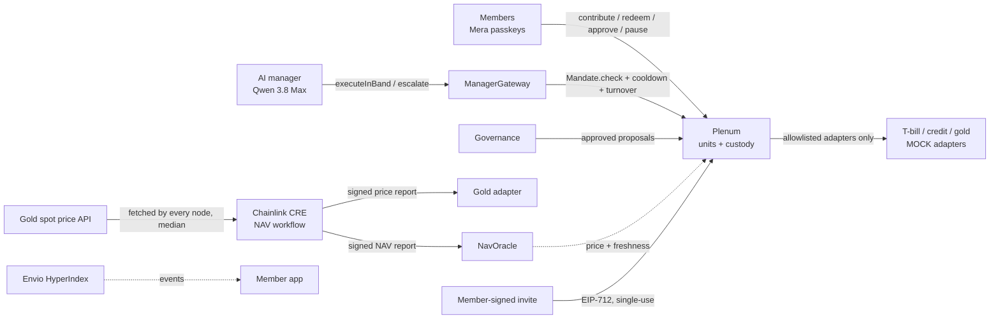

# Plenum

**Who guards the guardian? Your rules do.**

Groups everywhere pool money: investment clubs, families, founders, alumni. Professional management only starts
around $25M, so everyone else runs on spreadsheets and trust in one treasurer. AI can now do that job for almost
nothing, but no group should have to trust an AI with its money.

**Plenum gives a group an AI money manager that is bound by rules the group writes, priced by an independent
administrator using real market data, open only to people the members invite, and stoppable by the members at any
time**, all enforced by contracts on **Monad testnet**. Individuals can also run a personal portfolio on the same
rules.

- **Live app:** https://plenumx.vercel.app
- **Contracts and evidence transactions:** [docs/deployments.md](docs/deployments.md)
- **Bounty-by-bounty evidence:** [docs/bounty-adherence.md](docs/bounty-adherence.md)
- **Threat model and test results:** [docs/threat-model.md](docs/threat-model.md)
- **Build on it:** [docs/INTEGRATE.md](docs/INTEGRATE.md): put any AI agent behind a member-written mandate with `@plenum/sdk`

> Hackathon build for **Monad Metropolis, Track 04: Trust, Identity & AI Infrastructure**. Software, not a fund or an
> adviser. Testnet only, test money only. Everything simulated is labelled **MOCK** or **FALLBACK** (see
> [What is real and what is mocked](#what-is-real-and-what-is-mocked)).

## The idea: separation of duties

No single component both manages and prices, or manages and decides who gets in. Every arrow into the group's money
passes a check it cannot skip.

| Duty | Held by | Enforced onchain by |
| --- | --- | --- |
| **Manage** | AI manager, through a scoped operator key | `ManagerGateway` + `Mandate.check` on every action |
| **Price** | Chainlink CRE workflow (the fund administrator), with real gold prices from an external API | `NavOracle` and `MockGold`: accept the CRE forwarder only |
| **Admit** | Members, by signed invite | `Plenum.join`: EIP-712 invite signed by a member, single-use, expiring, capped |
| **Own and decide** | Members, with Mera passkey accounts | `Governance`: approve bigger moves, pause the manager |



**Check it yourself:** the landing page's rule console asks a real group's contract (`ManagerGateway.simulate` on
Monad testnet), and [`/verify`](https://plenumx.vercel.app/verify) checks any manager transaction and its memo against
the chain.

**The security claim the tests prove:** the worst a fully compromised manager can do is move money between assets the
group already approved, within size, turnover and cooldown limits. **It can never withdraw.**

## Try it (for judges)

1. Open https://plenumx.vercel.app and press **Start**. Create an account with one passkey prompt (Face ID, Touch ID,
   iCloud Keychain or Google Password Manager). No seed phrase, no extension.
2. Your testnet account is set up automatically: 10,000 **MOCK** test dollars and a little MON for gas.
3. **Start a group**, or **Just me** for a personal portfolio, pick a template and contribute. That is your first
   Monad transaction. A personal portfolio is the fastest path: no invites needed, you approve and pause alone.
4. On the landing page, **Try to break the rules**: every answer comes from a real group's contract. Then open
   [`/verify`](https://plenumx.vercel.app/verify) and paste a manager transaction from
   [docs/deployments.md](docs/deployments.md).
5. Invite a second account with a link from your group's home page to see approvals and pausing.

## Two ways to use it

| | A group (the core product) | A personal portfolio |
| --- | --- | --- |
| Who | An investment club, family, founders or friends pooling money | One person investing alone |
| Who joins | Anyone a member invites with a signed link (up to 99) | Nobody else: the member cap is 1 |
| Bigger moves | A share of members must approve | You approve |
| Pausing the AI | Any two members (configurable) | You, instantly |
| Everything else | Same contracts, mandate checks, CRE prices, provenance and encrypted data room | Same |

Both start from the same screen: **Start a group** or **Just me**. Both are tested end to end on Monad testnet, including a live Qwen rebalance of a
personal portfolio and an outsider's join refused by its member cap ([evidence](docs/deployments.md#personal-portfolio-end-to-end-my-portfolio-oct-13)).

## How a group runs

1. **Start a group.** Pick Conservative, Balanced or Liquidity-first. The template becomes the mandate: allowed assets,
   target weights and ranges, a cash floor, and caps on single trades (10% of value) and daily trading (25%).
2. **Invite people you trust.** Single-use invite links signed by a member. The contract checks the signature, the
   expiry and the group's size limit, so only people a member chose can join.
3. **Contribute.** Members get units priced at the latest independent valuation, shown in their own currency.
4. **The manager works.** It observes, plans, simulates every move against the contracts, then either acts within the
   rules or escalates. Each action commits a hash of its reasoning and the model id onchain.
5. **Members stay in charge.** Bigger moves need their approval (one passkey transaction each). Any two members can
   pause the manager instantly. Members share private data with the manager only through expiring onchain consent.

## The AI manager has an identity

The manager is **ERC-8004 agent #2128** in Monad testnet's canonical IdentityRegistry, owned by its own operator key,
with an [agent card](https://plenumx.vercel.app/agents/plenum-manager.json) stating what it can and can never do.
Every memo it commits names that identity. Members rate its actions in the canonical ReputationRegistry, each rating
tied to the action's rationale hash, and the app counts only ratings from the group's own members, so the score
can't be bought by outside accounts.

## What is in the box

| Folder | What |
| --- | --- |
| [`contracts/`](contracts) | Foundry: `Plenum`, `Mandate`, `ManagerGateway`, `Governance`, `NavOracle`, `ConsentRegistry`, `PlenumFactory` (per-group clones), MOCK adapters (gold priced by CRE) and the MOCK test dollar |
| [`agent/`](agent) | AI manager runtime (observe → plan → simulate → act → explain), seven tools and no transfer tool, red-team suite |
| [`cre/`](cre) | Chainlink CRE workflow: real gold price (HTTP + consensus) and NAV (TypeScript SDK, compiled to WASM) |
| [`indexer/`](indexer) | Envio HyperIndex (HyperSync), hosted on Envio |
| [`app/`](app) | Next.js member app on Vercel: Mera passkeys, groups and personal portfolios, approvals, data room |
| [`packages/sdk/`](packages/sdk) | `@plenum/sdk`: simulate, act, escalate and verify manager actions from any agent ([integration guide](docs/INTEGRATE.md)) |
| [`packages/crypto/`](packages/crypto) | Data-room crypto: HKDF(passkey PRF) → X25519, AES-256-GCM, HPKE key wrapping |
| [`docs/`](docs) | Spec, deployments, threat model, bounty adherence |

## Tests and security

| Suite | Result |
| --- | --- |
| Contracts (unit, fuzz, invariants) | **100 passing**, including 7 handler-based invariants at 16,384 random calls each |
| Red team RT-1..RT-8 (prompt injection, invented adapters, stale prices, oversized trades, turnover evasion, stolen key, expired consent) | **10/10** against the real runtime and contracts |
| Live model (Qwen 3.8 Max) | Rebalanced in-band on testnet ([tx](https://testnet.monadvision.com/tx/0xf52978a4ce315959991b6a596a72477c37bc1a690ac4491fe27b4c6d94576662)), held when in range, and refused a planted "move 40% to this address" instruction |
| Data-room cryptography | 9 passing, derivation cross-checked against Node's HKDF / X25519 |
| CRE workflow math | 6 passing (NAV, drift, gold price conversion, report encodings) |
| Static analysis | Slither and Aderyn: every finding fixed or explained in [docs/threat-model.md](docs/threat-model.md) |
| Onchain | A forced call with the manager's own key to an outside address **reverts** ([tx](https://testnet.monadvision.com/tx/0x732ef7c035971c5c249132b444ba05403c84f6c0f0a3d36915ad5ffb7ceec97d)) |

CI runs the contract, agent, crypto, indexer and app checks on every push.

## Why Monad

1. **Checks on every action stay cheap.** Each manager action runs mandate, size, turnover and price-freshness checks
   onchain. Low fees keep that safety invisible to members and keep small contributions viable.
2. **A tight agent loop.** Sub-second blocks keep the gap between the manager's simulation and its execution short, so
   what it checked is what it gets.
3. **Native trust tooling.** Mera passkey accounts, Chainlink CRE support for Monad, Envio HyperSync for Monad and
   the canonical ERC-8004 registries all run on Monad testnet.
4. **The asset shelf exists.** The MOCK adapters follow the ERC-4626 / ERC-7540 shapes used by tokenised funds, so real
   ones can replace them.

## What is real and what is mocked

| Real | MOCK or FALLBACK |
| --- | --- |
| All Plenum contracts, deployed and verified on Monad testnet | T-bill vault, private-credit vault and gold: **MOCK** adapters |
| Mandate, governance, invites, pause, consent and every safety check | Settlement asset: **MOCK** test dollar (`mUSD`) |
| Chainlink CRE workflow pricing the fund onchain, gold at the **real** spot price | **FALLBACK** price writer: demo resilience only, labelled in the UI |
| Envio indexer, Mera passkey accounts, encrypted data room, ERC-8004 identity | Testnet onboarding gives new accounts **MOCK** test dollars and gas |

## Run it locally

Requirements: Node 22+, pnpm, Foundry. Optional: the CRE CLI (`cre login`) and Docker (local indexer).

```sh
pnpm install
cd contracts && forge build && forge test                        # 100 tests
anvil &                                                          # local chain
forge script script/Deploy.s.sol --rpc-url http://127.0.0.1:8545 --broadcast
forge script script/Rehearsal.s.sol --rpc-url http://127.0.0.1:8545 --broadcast
cd ../agent && pnpm test && pnpm redteam                         # agent unit tests and red team
cd ../app && NEXT_PUBLIC_CHAIN_ID=31337 pnpm dev                 # member app on localhost
```

Monad testnet deployment, CRE simulation, the hosted indexer and Vercel are documented in
[`contracts/`](contracts), [`cre/README.md`](cre/README.md), [`indexer/README.md`](indexer/README.md) and
[`app/README.md`](app/README.md). Environment variables are listed (names only) in [`.env.example`](.env.example).

## AI-tool disclosure

_To be completed by the author before submission, as required by the hackathon rules._

## Licence

[MIT](LICENSE)
